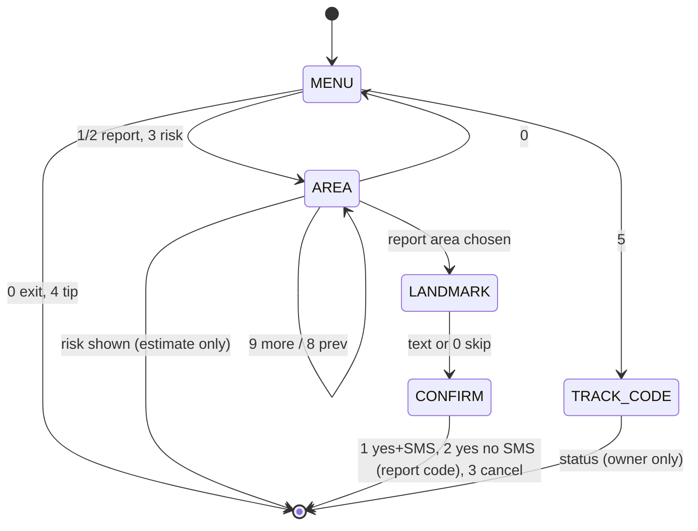

# USSD flow (optional until provisioned)
Implemented: the **session state machine** (`domain/ussd-machine.ts`) and the **Applink USSD adapter + callback** per the official docs (`ussd.adapter.ts`, `callbacks.ts`), tested with documented-shape payloads but **not yet live-tested**. Flow: AppLink POSTs user input to our `/webhooks/applink/ussd/receive` → we acknowledge `S1000` immediately → the machine produces `{text, continueSession}` → we push it with `POST /ussd/send` (`mt-cont`, or `mt-fin` when the session ends). `mo-init` always restarts at the menu; the real AppLink `sessionId` is the session key and the idempotency key; repeated `requestId`s are ignored.

All screens are plain ASCII and <= 160 characters (asserted in tests). Bangla Unicode is not used.

Handled: invalid input (3 strikes end the session), expired session (restarts at menu, stale input ignored), duplicate submit/retry (idempotent on session id), empty area list, daily per-phone limit. A report made over USSD is **awaiting review**; the confirmation screen says "Keep it to track your report".
